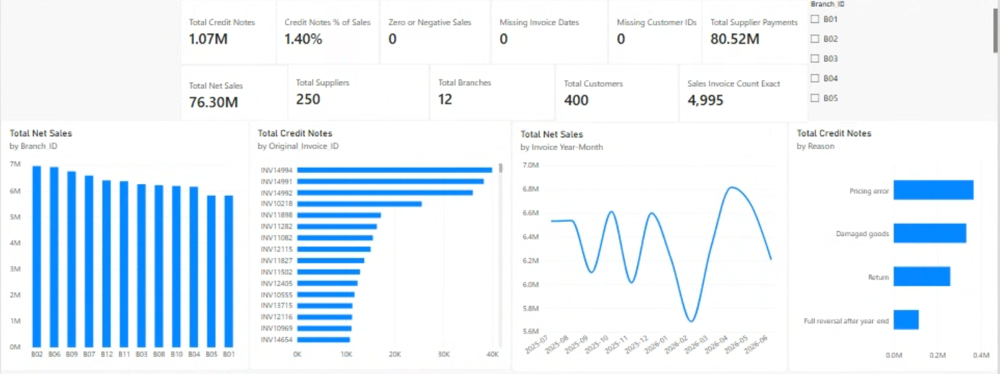
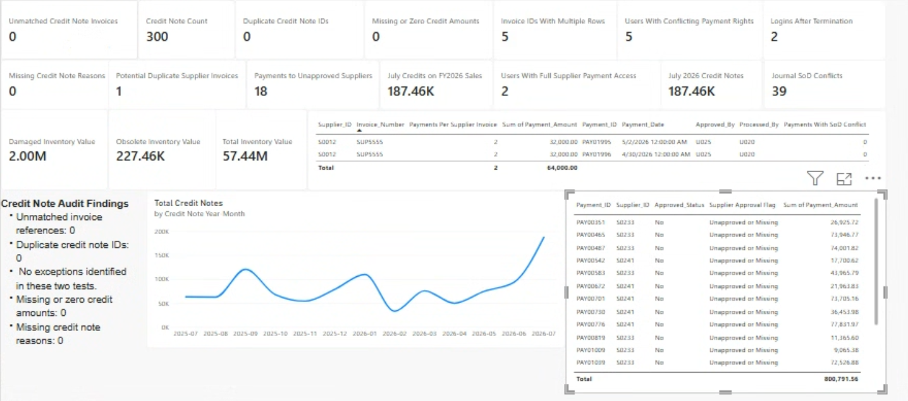
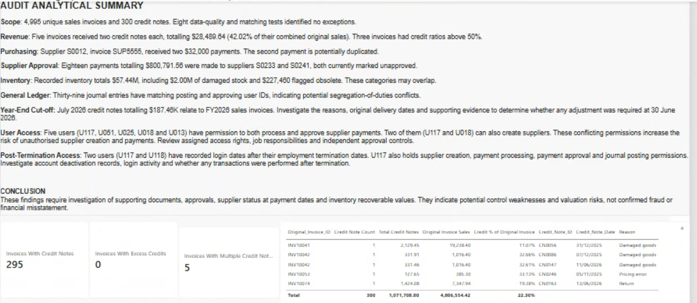

# Power BI Audit Analytics | Retail Financial Data

An end-to-end audit analytics project using Microsoft Power BI, DAX, and relational data modelling to identify financial reporting risks, unusual transactions, and internal control weaknesses.

## Project Overview

This project analyses a retail business across five audit areas:
- Revenue and accounts receivable
- Purchasing and accounts payable
- Inventory valuation
- General ledger and journal entries
- User access and segregation of duties

The Power BI report contains three interactive pages.

## 1. Audit Overview

Provides an overview of:
- $76.30M in net sales
- 4,995 unique sales invoices
- $80.52M in supplier payments
- 400 customers, 250 suppliers, and 12 branches

Includes branch filtering, monthly sales trends, and credit note analysis.

## 2. Risks & Exceptions

Uses DAX calculations and transaction-level analysis to identify potential audit exceptions across purchasing, inventory, revenue, journals, and access controls.

## 3. Audit Findings & Drill-through

Summarises audit findings and supports investigation of individual invoices and credit notes using Power BI drill-through functionality.

## Key Audit Findings

| Audit Area | Finding |
|---|---|
| Revenue | Five invoices received multiple credit notes totalling $28,489.64 |
| Revenue cut-off | $187.46K in July 2026 credit notes relating to FY2026 sales |
| Purchasing | Potential duplicate supplier payment of $32,000 |
| Supplier approval | 18 payments totalling $800,791.56 to currently unapproved suppliers |
| Inventory | $2.00M in damaged stock and $227,460 flagged obsolete |
| General ledger | 39 journal entries with matching posting and approving user IDs |
| Access controls | Five users with conflicting payment permissions |
| Data quality | Five reused sales invoice IDs with conflicting transaction details |

These findings represent potential risks requiring further audit investigation, not confirmed fraud or misstatements.

## Technical Skills Demonstrated

- Power BI dashboard design
- DAX measures and calculated tables
- Relational data modelling
- Data quality validation
- Financial transaction analysis
- Audit risk identification
- Segregation-of-duties testing
- Interactive filtering and drill-through

## Project Files

The repository includes the Power BI report and screenshots of its three dashboard pages.

## Important Note

This project was developed for academic audit analytics. Findings are based on analytical testing and require supporting audit evidence before final conclusions can be reached.
